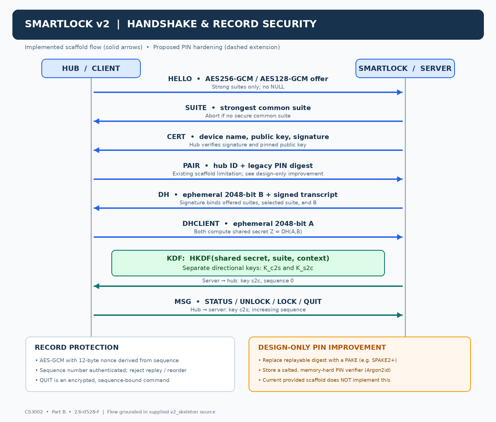
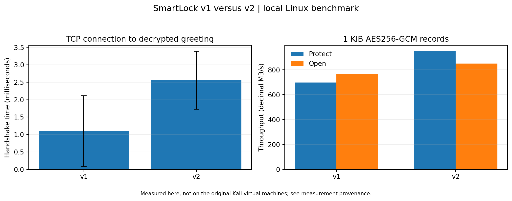

# SmartLock Security Hardening

**From vulnerable protocol analysis to authenticated, replay-resistant records in C++17 and OpenSSL.**

A security engineering project by **Zohaib Umer**, developed for CS3002 Information Security. This repository brings together five SmartLock v1 vulnerability demonstrations, a v2 cryptographic record module, verification evidence, and comparative benchmarks.

[Implementation](securelink2.cpp) · [Lab guide](docs/LAB_GUIDE.md) · [Report](23i-0528-F-REPORT%20%281%29.pdf) · [Test source](evidence/23i-0528-F-TASKC-V1.cpp) · [Benchmark data](performance/benchmark_summary.csv)

## What I implemented

The core contribution is [`securelink2.cpp`](securelink2.cpp):

- **Strong cipher-suite selection:** AES-256-GCM is preferred, AES-128-GCM is supported, and NULL-only offers are rejected.
- **HKDF-SHA256 key derivation:** suite and caller-supplied context separate derived keys, including client-to-server and server-to-client directions.
- **Per-record nonces:** a 12-byte nonce encodes the record sequence number.
- **Authenticated encryption:** AES-GCM protects the payload and authenticates the sequence number as additional data.
- **Replay and ordering checks:** received sequence numbers must match the caller's expected value.
- **Defensive validation:** malformed records, unsupported keys, empty derivation inputs, and failed authentication are rejected.

The repository also includes C++ attack demonstrations, Python relay addons, a core self-check suite, captured network evidence, and a benchmark harness. Certificate verification, signed handshake transcripts, and the 2048-bit DH exchange belong to the original v2 scaffold; that scaffold is required separately.

## Protocol design



The diagram distinguishes the scaffold's handshake from the record-security module and the proposed PIN improvement. The PIN redesign is **not implemented**.

## Vulnerabilities explored

| Lab | SmartLock v1 investigation | v2 defense or verification |
| --- | --- | --- |
| A1 | NULL-suite downgrade and plaintext exposure | Strong-suite policy and downgrade rejection |
| A2 | Certificate substitution / man-in-the-middle relay | Scaffold certificate and transcript verification |
| A3 | Weak Diffie-Hellman secret recovery from captured traffic | Scaffold 2048-bit ephemeral DH; recorded group checks |
| A4 | Nonce reuse and ciphertext XOR analysis | Sequence-derived nonces with directional keys |
| A5 | Captured-command replay | Authenticated sequence numbers and expected-sequence checks |

See [`exploits/`](exploits/) for demonstrations and [`evidence/`](evidence/) for captures, screenshots, logs, and relay addons. Recovered values in `answers.txt` are coursework lab artifacts.

## Repository layout

```text
securelink2.cpp                 v2 cipher policy, HKDF, and AEAD record module
exploits/                      A1 instructions and A2–A5 C++ demonstrations
evidence/                      Packet captures, screenshots, logs, and tests
  tool_addons/                 Python mitmproxy addons
performance/                   Benchmark source, raw CSVs, summary, and PNG chart
docs/LAB_GUIDE.md               Detailed build and reproduction instructions
answers.txt                    Recovered lab values
23i-0528-F-REPORT (1).pdf        Original coursework report
```

Original artifact filenames are retained so the report and evidence remain traceable.

## Build and run

**This is an implementation-and-evidence repository, not a standalone SmartLock distribution.** The original course-provided `smartlock/` and `v2_skeleton/` directories, their headers and build files, and the original `instance.txt` are not included.

Use Linux (or a Linux environment on Windows), a C++17 compiler, **OpenSSL 3.x** development headers and `libcrypto`, and `make`. Relay experiments additionally need mitmproxy; capture inspection uses Wireshark or tshark.

After placing the original scaffold directories alongside this repository's files:

```bash
# Install the implemented module into the supplied scaffold.
cp securelink2.cpp v2_skeleton/securelink2.cpp
make -C v2_skeleton

# Build and run the included core verification suite.
g++ -std=c++17 -O2 -Wall -Wextra \
  -I smartlock -I v2_skeleton \
  evidence/23i-0528-F-TASKC-V1.cpp v2_skeleton/securelink2.cpp \
  -o smartlock_selftest -lcrypto
./smartlock_selftest
```

The [lab guide](docs/LAB_GUIDE.md) contains the A2–A5 build commands, relay setup, capture-based recovery commands, and benchmark reproduction steps. Run those commands from the combined project root, not from `docs/`.

## Verification evidence

The [included test log](evidence/C_A4_aead_test.txt) records **11 passing core checks**, covering suite policy, directional key derivation, AES-128/256 round trips, nonce construction, replay/order rejection, ciphertext/tag/header tampering, and truncated records.

These are archived results from the project. Publishing this repository does not constitute a fresh execution of the tests; the missing course scaffold is needed to rerun them. The [evidence index](evidence/23i-0528-F-evidence_index.txt) also distinguishes packet-structure checks from exploit-success claims and identifies generated audit material.

## Performance



Archived measurements use 30 handshake sessions per version and five runs of 10,000 records per version, with 1 KiB plaintext records. Values below are mean ± sample standard deviation.

| Measurement | v1 AES-256-GCM | v2 AES-256-GCM |
| --- | ---: | ---: |
| Handshake latency (ms) | 1.102 ± 1.016 | 2.558 ± 0.829 |
| Protect time (µs/record) | 1.47 ± 0.11 | 1.08 ± 0.05 |
| Open time (µs/record) | 1.33 ± 0.05 | 1.20 ± 0.01 |
| Protect throughput (MB/s) | 698.7 ± 48.9 | 948.6 ± 43.0 |
| Open throughput (MB/s) | 769.1 ± 29.4 | 850.5 ± 7.1 |
| Complete wire MSG line (bytes) | 2,124 | 2,110 |

In this run, v2 added handshake work while improving record-processing throughput. These measurements are environment-specific, not a universal performance guarantee.

**Measurement provenance:** the recorded benchmark ran on 2026-11-10 in a Linux container on an AMD EPYC 9V74 host with five exposed vCPUs, GCC 14.2.0, OpenSSL 3.5.5, and `-O2`. It was **not** measured on the original Kali/VirtualBox lab machines. See [environment details](performance/benchmark_environment.txt), [raw measurements](performance/), and the [summary CSV](performance/benchmark_summary.csv).

## Scope and limitations

- The scaffold's legacy PIN-digest weakness remains. PAKE and a memory-hard PIN verifier are design proposals only.
- Nonce uniqueness requires a distinct key per session/direction and no sequence-number reuse under that key. The caller manages sequence state and must prevent wraparound.
- Replay protection depends on the caller advancing the expected sequence number after successful authentication.
- This is an educational protocol implementation with archived lab evidence, not a production security library.
- Use the demonstrations only in a lab or on systems you are authorized to test.

## Author

**Zohaib Umer** · CS3002 Information Security · Assignment 2 · Section F

The original report and filenames retain the coursework identifier `23i-0528` for evidence traceability.

## Further reading

- [Record security design](docs/SECURITY_DESIGN.md): binary format, key derivation, and caller responsibilities.
