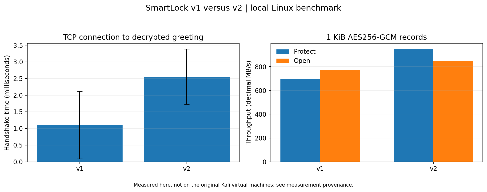

# Benchmark data and methodology

[Benchmark source](23i-0528-F-TASKD-V1.cpp) · [Summary](benchmark_summary.csv) · [Environment](benchmark_environment.txt) · [Build and run instructions](../docs/LAB_GUIDE.md#part-d--performance-testing)

## Inputs and outputs

| File | Measurement |
| --- | --- |
| [v1_handshakes.csv](v1_handshakes.csv) | 30 v1 connection-to-greeting measurements |
| [v2_handshakes.csv](v2_handshakes.csv) | 30 v2 connection-to-authenticated-greeting measurements |
| [v1_records.csv](v1_records.csv) | Five v1 record-processing runs plus wire-size measurements |
| [v2_records.csv](v2_records.csv) | Five v2 record-processing runs plus wire-size measurements |
| [benchmark_summary.csv](benchmark_summary.csv) | Mean and sample standard deviation for each metric |

Raw rows use `version,metric,run,value,unit`. Summary rows use `version,metric,n,mean,sample_sd,unit`. Wire-size rows are deterministic size measurements with `n=1`; their zero standard deviation does not represent repeated timing trials.

## Timing boundaries

Handshake timing starts immediately before TCP connection and stops after decrypting and checking the server greeting. The v2 client also verifies the pinned public key, certificate signature, and signed DH transcript. Sending QUIT and closing the connection occur after the timed interval.

Record tests use 1,024-byte payloads and at least 10,000 records per run, with at least five runs. Protection and opening are timed separately. The protection loop includes storing ciphertext buffers; the opening loop includes a plaintext equality check. These are harness-level measurements rather than isolated cipher-instruction timings.

## Units and aggregation

- Latency is stored in microseconds; the main README converts handshake latency to milliseconds.
- Throughput uses decimal MB/s: plaintext bytes divided by 1,000,000 and by elapsed seconds.
- Record statistics summarize run-level measurements, not individual record timings pooled across runs.
- Sample standard deviation uses `n - 1` in the denominator.
- Wire size includes the complete tab-separated, hex-encoded MSG line and newline, excluding TCP/IP headers.

## Interpretation and limitations

The archived run used a Linux container on 2026-11-10, not the original Kali/VirtualBox lab machines. CPU scheduling, virtualization, compiler settings, and warm-up can change absolute timings; consult the environment file when comparing results.

The v1 benchmark deliberately preserves its insecure static nonce baseline. The v2 record microbenchmark also restarts sequence numbers for each timed run under a fixed synthetic key. That repetition is confined to this disposable timing workload and must not be copied into a live session. Real sessions require fresh keys and non-repeating sequence numbers.

For a new comparison, use the same machine and compilation settings for both versions, save results separately from this archive, record your environment, and regenerate the summary and chart from those new measurements.
